# SaldoClaro

App de finanzas personales para Android que responde dos preguntas:
**¿en qué se me va la plata?** y **¿me va a alcanzar?**

Está pensada para quien no tiene un ingreso fijo: freelancers, gente con
ingresos variables o que hoy vive de entradas sueltas. Funciona desde el día 1
con solo gastos, sin pedir sueldo ni día de pago, y calcula cuántos días te
alcanza la plata con tu ritmo de gasto real.

Sin cuenta, todo se guarda en el teléfono y la app no se conecta a internet. La
cuenta es opcional: si la creas, tus datos se sincronizan con la nube (Supabase)
para usarlos en otro teléfono.

## Pantallas

| Onboarding | Home | Registro |
|---|---|---|
| 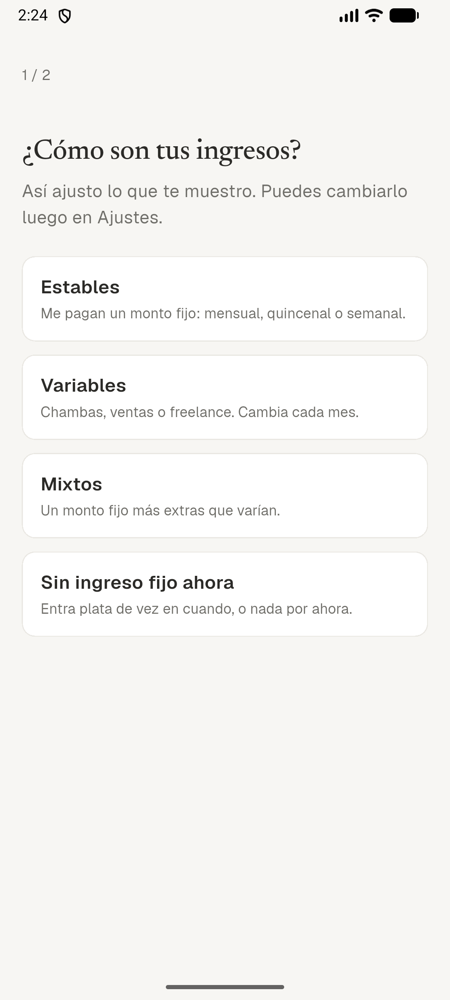 | 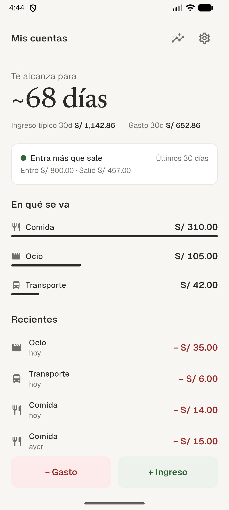 | 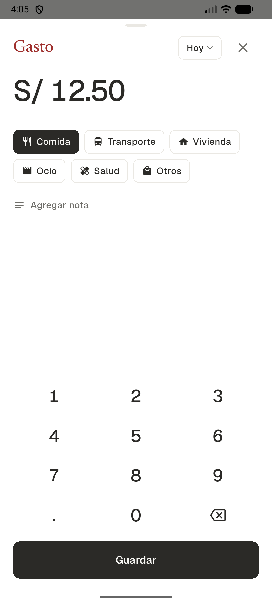 |

- **Onboarding de 2 pasos:** elige cómo son tus ingresos (Estables, Variables,
  Mixtos o Sin ingreso fijo) y, si quieres, un nombre. No pide montos.
- **Home adaptativo por modo:**
  - Estable: cuánto te queda del presupuesto del mes;
  - Variable: cuántos días te alcanza, con ingreso típico y gasto de 30 días;
  - Supervivencia: cuántos días te alcanza y cuánto gastas al día.

  Además: semáforo de entradas y salidas, en qué se va la plata y movimientos
  recientes con Deshacer.
- **Registro en 2 toques:** teclado propio, categoría o fuente preseleccionada
  y borrador que sobrevive si cierras la app.
- **Ajustes:** modo, nombre, saldo inicial, ventana del cálculo, categorías y
  fuentes, exportación a CSV (lista para Excel en Perú).

| Presupuesto | Insights (Estable) | Insights (Supervivencia) |
|---|---|---|
| 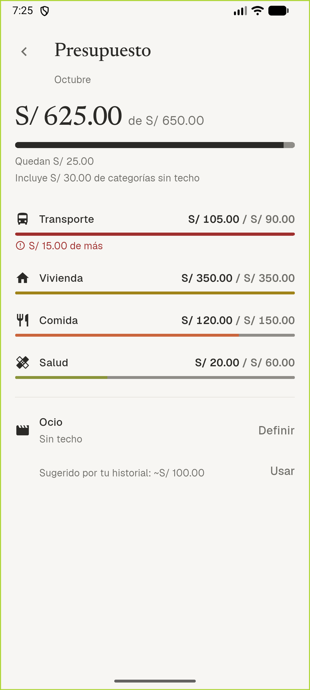 | 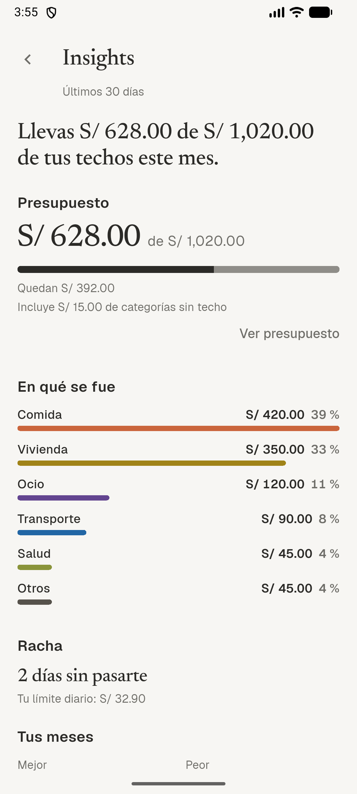 | 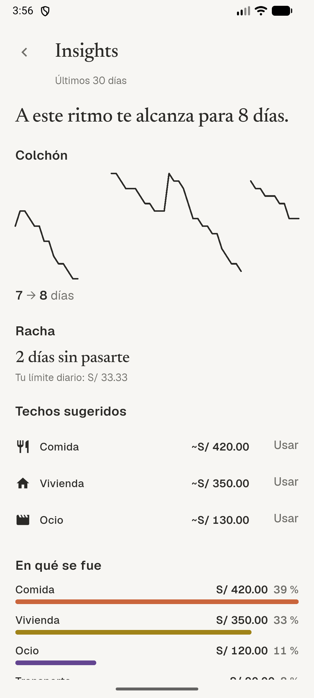 |

| Ajustes | Saldo inicial | Insights (oscuro) |
|---|---|---|
| 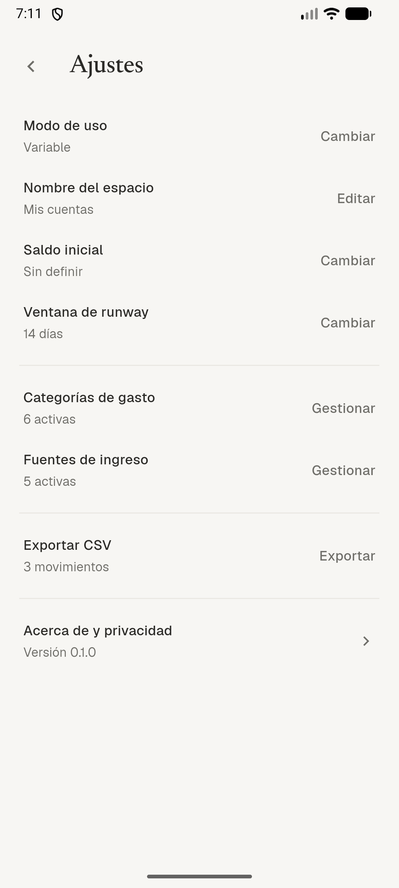 | 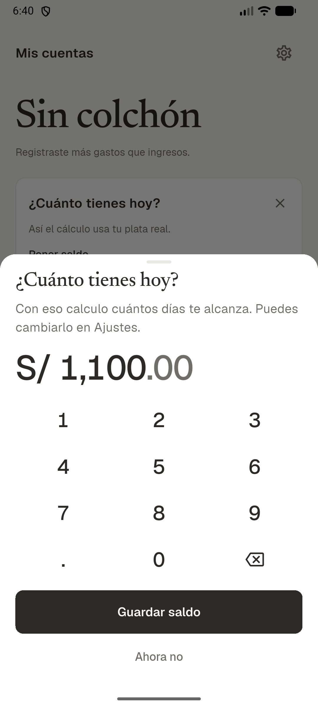 | 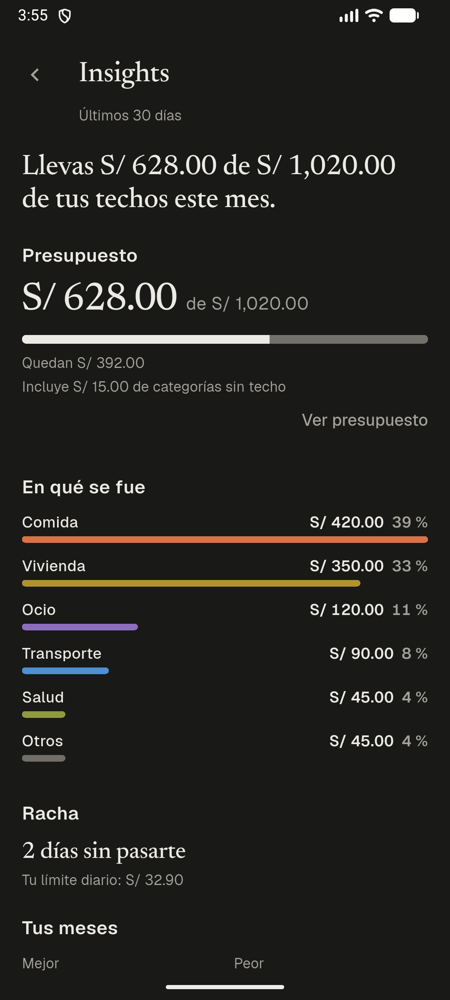 |

- **Presupuesto (modo Estable):** un techo mensual por categoría contra el
  gasto real, con sugerencias sacadas de tu historial.
- **Insights:** en qué se fue la plata en 30 días, cómo se movió tu reserva en
  60 días, tu racha sin pasarte del límite diario y tus mejores y peores meses.
  El orden de los bloques cambia según el modo.

| Home con sync | Detalle de sync | Sin conexión |
|---|---|---|
| 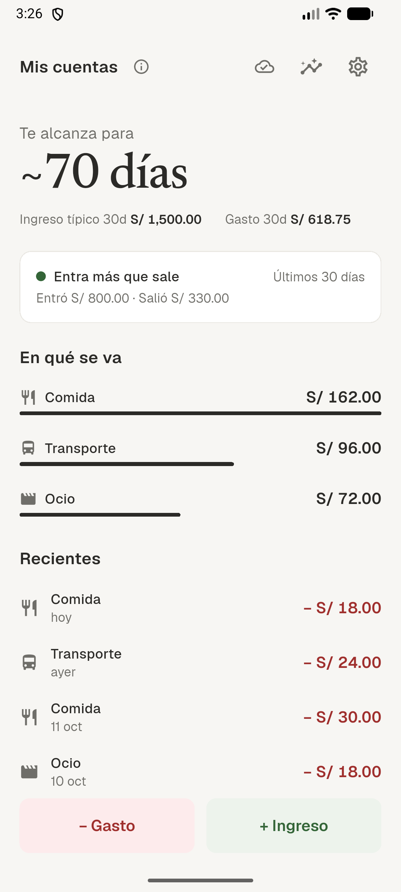 | 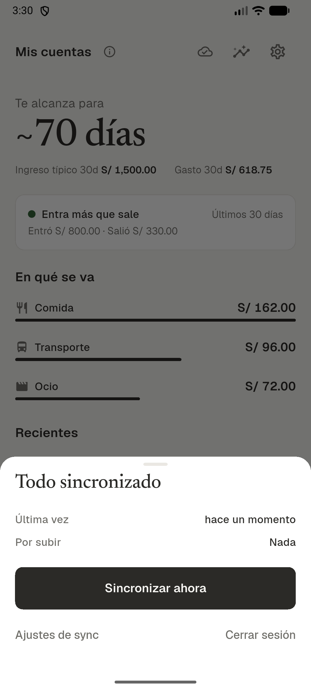 | 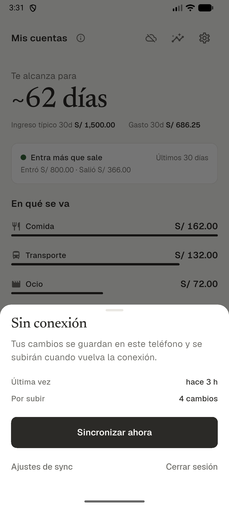 |

- **Sincronización opcional (Fase 3):** cuenta con correo y contraseña en
  Ajustes, Sincronizar con la nube. Bidireccional entre teléfonos (último en
  escribir gana), automática al abrir, al volver y después de cada cambio. Un
  ícono en el header del Home muestra el estado y, al tocarlo, el detalle.

Más capturas, en claro y oscuro, en [`docs/screenshots/`](docs/screenshots/).

## Stack

- **Flutter** (stable) + **Riverpod** para el estado.
- **drift** (SQLite) para la persistencia local, con streams reactivos: el Home
  se recalcula solo al guardar.
- **supabase_flutter** solo para la sincronización opcional: sin sesión no abre
  conexiones. Las fuentes Newsreader y Geist van como asset (licencia OFL).
- Los gráficos son propios (barras con widgets y la línea con `CustomPainter`),
  sin librería de gráficos. La paleta de categorías se validó para daltonismo.
- Las métricas (runway, promedios, semáforo, presupuesto, insights) son funciones puras
  en `lib/domain/metrics.dart`, escritas con TDD. El dinero se maneja siempre
  en centavos enteros.

## Cómo compilar

```bash
flutter pub get
dart run build_runner build   # genera lib/data/database.g.dart (drift)
flutter run
```

La sincronización (opcional) necesita `lib/core/config/secrets.dart`, que no está en
el repo (`.gitignore`). Créalo con la URL y la anon key de tu proyecto de Supabase:

```dart
abstract final class Secrets {
  static const supabaseUrl = 'https://<proyecto>.supabase.co';
  static const supabaseAnonKey = '<anon key>';
}
```

Nunca la `service_role`. El esquema del servidor está en `supabase/migrations/`.

```bash
flutter test      # suite completa
flutter analyze
```

En Windows, `flutter pub get` pide activar el Modo de desarrollador
(`start ms-settings:developers`).

## Estado

**Fase 3 completa** (tag `fase-3-completa`): sync opcional con Supabase. 600
tests, `flutter analyze` limpio. La publicación (Fase 2C) espera la cuenta de
Play Console y el SMTP propio.

- **Fase 1** (`fase-1-completa-v2`): app local completa. 1a datos y fórmulas;
  1b Onboarding, Home, registro y Ajustes; 1c Presupuesto e Insights.
- **Fase 2** (`fase-2-*`): explicación de los modos, política de privacidad y
  términos, preparación para Play Store y landing.
- **Fase 3** (`fase-3a` … `fase-3-textos`): 3A esquema del servidor con RLS;
  3E columnas de sync en local; 3B cuenta opcional (crear, entrar, recuperar,
  borrar); 3C sync bidireccional; 3D ícono de estado; Textos legales con el
  consentimiento al crear la cuenta.

## Roadmap

| Fase | Qué entra |
|---|---|
| **1** ✅ | MVP: app local completa con registro, Home por modo, Presupuesto e Insights |
| **2A/2B** ✅ | Legal (privacidad, términos) y preparación para Play Store |
| **2C** ⏸️ | Publicación beta cerrada: pendiente la cuenta de Play Console (25 USD) y el SMTP propio |
| **3** ✅ | Sync opcional con Supabase: 3A, 3E, 3B, 3C, 3D y Textos |
| **4** | Multi-cuenta, captura de notificaciones (experimental), recordatorios de facturas, historial completo |
| **5** | IA real (siempre detrás de un backend proxy, nunca con API keys en el APK) y publicación pública |

El detalle de producto, fórmulas y decisiones está en [`SPEC.md`](SPEC.md). El
plan de trabajo, en [`tasks/todo.md`](tasks/todo.md).
